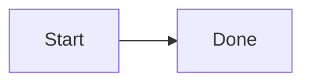

# gbot_cli 😊 🤝

An unofficial Windows terminal client for Grok Bot. Chat with bots and channels,
send follow-ups while a reply is in progress, and act on cards in the conversation.

[](#quick-start)
[](#quick-start)
[](LICENSE)

[Quick start](#quick-start) · [Reading replies](#reading-replies) · [Architecture](#architecture) · [Keyboard controls](#keyboard-controls) · [Contributing](#contributing)

## Quick start

Use Windows Terminal or PowerShell with Git and Node.js 24 or later. Try the
offline demo from a fresh checkout.

```powershell
git clone https://github.com/Bowen-Xue-ac2/gbot_cli.git
cd gbot_cli
npm ci
npm run gbot -- --mock
```

For live chat, sign in to the Grok Bot desktop app first. Then check the connection
and open the bot and channel list.

```powershell
npm run gbot -- --check
npm run gbot
```

`--check` reports bot and channel counts without sending a chat message.
Use `npm run gbot -- --agent "Bot Name"` to open a chat directly.
Subcommands such as `bots list` and `approvals list` run through the pinned upstream CLI.

## Features

- **Keep chatting.** Send another prompt while a reply is in progress. Incoming replies appear as the transcript updates.
- **Route a request.** Type `@` to choose a bot or connected Grok Bot app, or `/` to choose a skill. Type part of its name to filter. You can select several items in one message. The bot receives their IDs when you send.
- **Recover reads after gateway sleep.** Refresh the session and retry once when HTTP 417 identifies a sleeping gateway.
- **Act on bot messages.** Answer choices, respond to supported approvals, and review or edit email drafts in the original card.
- **Read formatted replies.** View Markdown headings, lists, and tables, Mermaid diagrams, and LaTeX fractions and matrices in the terminal. Press **Ctrl+R** to see the source.

## Reading replies

Bot replies open in reader view. Press **Ctrl+R** to inspect the original Markdown,
TeX delimiters, or Mermaid definition. Press it again to return to the reader.

Left-click an underlined web link in reader view to open it in your default
Windows browser. This works with Markdown links and plain HTTP or HTTPS URLs.

### Markdown and diagrams

A reply containing `### Results`, `**net revenue**`, and `- [x] Checked`
displays a heading, bold text, and a checked list item. Nested lists keep their
indentation, and a vertical bar marks quoted passages. Tables use aligned
columns when space permits. In a narrow pane, each record can expand vertically
with its column names beside the values.

A fenced `mermaid` block such as the following draws two connected boxes at
that point in the reply. If the diagram exceeds the pane width or the renderer
cannot draw it, you can still read its definition. Ordinary code blocks and
inline code preserve literal examples such as `$x^2$`.



### Formulas and matrices

Inline math stays in the sentence. For example, `$x^2 + \alpha$` reads as
`x² + α`, and `\(\Delta Q\)` reads as `ΔQ`. Display math between `$$`
delimiters can span several terminal rows. The expression
`$$MC=\frac{\Delta TC}{\Delta Q}$$` appears as:

```text
     ΔTC
MC = ───
      ΔQ
```

Matrix columns align even when entries have different widths. For example,
`$$A=\begin{pmatrix}1&20\\300&4\end{pmatrix}$$` appears as:

```text
A = ⎛  1   20 ⎞
    ⎝ 300   4 ⎠
```

Wide fractions can switch to grouped slash notation. Inline matrices and
matrices too wide for the pane use commas between columns and semicolons between
rows, as in `[1, 0; 0, 1]`. Unsupported TeX and unfinished display blocks stay
visible as source.

## Architecture

| Layer | How it works |
| --- | --- |
| Command entry | The [Node.js entry point](bin/gbot.mjs) starts the interactive client for chat, mock mode, and connection checks. It delegates other subcommands to the pinned `grok-bot-cli`. |
| Terminal UI | The [launcher](src/launch.mjs) uses Node.js module load hooks to adapt the pinned React/Ink client from `grokbot-tui`. The adapters add card actions, routing pickers, and reader rows to the chat. |
| Live messages | The [Windows session adapter](src/windows-session.mjs) uses the active desktop account. The [send adapter](src/backend-send.mjs) submits the prompt. A [background transcript poll](src/tui-chat.mjs) brings replies into the same conversation, leaving the draft available for a follow-up. |
| Reply layout | The [Markdown reader](src/markdown-reader.mjs) turns `markdown-it` tokens into styled terminal rows. The [formula renderer](src/terminal-math.mjs) uses MathJax to parse TeX and lays out the result in Unicode cells. The [diagram renderer](src/rich-replies.mjs) uses `beautiful-mermaid` for text diagrams. Ink redraws formulas and surrounding prose in the same frame. |

## Keyboard controls

| Key | Action |
| --- | --- |
| **@** / **/** | Open the agent and app picker / skill picker |
| **↑ / ↓**, **Tab** or **Enter** | Choose a picker result and insert it into the draft |
| **Esc** | Dismiss the picker and keep the text you typed |
| **Enter** | Send the draft when the picker is closed |
| **Tab** | Focus a card when the picker is closed |
| **↑ / ↓**, **Enter** | Choose and confirm the focused card action |
| **y** | Confirm an email send when prompted |
| **Ctrl+R** | Toggle between formatted reply and Markdown source |

## Desktop account and data

The Windows adapter uses the account saved by the desktop app. Gateway credentials
stay in process memory. Runtime cache and temporary attachments are stored under
`%LOCALAPPDATA%\gbot-cli`. Gateway APIs can change, and some card types require
the desktop app. This project is independent of Grok Bot, Cursor, and xAI.

## Contributing

Run `npm test` for offline transport and terminal tests. Use `git commit -s -S`
to add a [DCO 1.1](DCO) sign-off . See the [contribution guide](CONTRIBUTING.md),
[security policy](SECURITY.md), and [changelog](CHANGELOG.md).

Released under the [MIT license](LICENSE). Upstream CLI and TUI projects are
credited in the [third-party notices](THIRD_PARTY_NOTICES.md).

Maintained by [@Bowen-Xue-ac2](https://github.com/Bowen-Xue-ac2) 😄🤝
